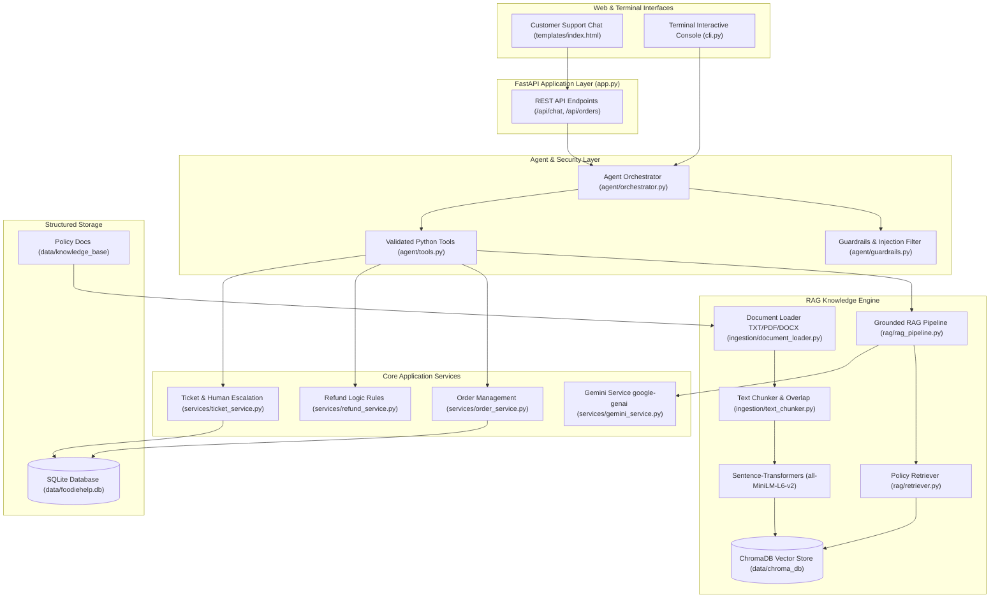

# FoodieHelp AI — AI-Powered Food Delivery Customer Support Platform

> **A production-grade, simulated food delivery customer support application combining Grounded RAG, Tool Calling, Deterministic Business Rules, and LLM General Knowledge & Mathematics Assistance.**
> **Built with Python 3.13 and a high-performance, responsive FastAPI web server with a built-in modern HTML5/JS interface and interactive Terminal CLI (Zero Streamlit dependencies).**

---

## 1. Project Overview

**FoodieHelp AI** is an intelligent customer support application built for simulated food-delivery services (similar to Zomato, Swiggy, Uber Eats, or DoorDash). It enables customers to interact naturally with an AI assistant that can:
- Answer official policy questions accurately with **Grounded Retrieval-Augmented Generation (RAG)** using PDF, TXT, and DOCX documents in natural, empathetic language without citing internal file names.
- Lookup real-time order status, items, and estimated delivery times using **Python Tool Calling**.
- Enforce strict, transparent **business rules for refunds** (missing items, wrong dishes, duplicate transactions, dietary violations).
- Safely simulate **order cancellation** gated by mandatory customer confirmation.
- Log **support complaints** and generate trackable support tickets.
- Escalate complicated or unresolved issues seamlessly to **simulated human support**.
- Seamlessly solve **mathematics calculations**, science queries, definitions, and external general knowledge questions using Google Gemini.
- Run either as a full **Web Application** at `http://localhost:8000` or as a pure **Interactive Terminal Console** via `python cli.py`.

> [!NOTE]
> This is a portfolio and educational application. It runs locally using SQLite and persistent ChromaDB. No real orders, restaurants, or payment gateways are touched.

---

## 2. Business Problem & Solution

### The Business Challenge
Modern food delivery platforms handle millions of customer inquiries daily:
- Customers frequently ask repetitive questions regarding delivery times, cold food, broken packaging, and refund timelines.
- When LLMs are allowed to invent answers without grounding, they "hallucinate" incorrect refund policies or make promises the business cannot keep.
- Rule-based chatbots feel rigid and cannot answer nuanced questions or understand natural language variations.

### The FoodieHelp AI Solution
FoodieHelp AI solves this with a **Dual-Engine Architecture**:
1. **Deterministic Business Engine (Python & SQLite):** Financial calculations, order status transitions, and cancellations are executed strictly by validated Python code and database transactions. The LLM is never allowed to unilaterally issue a refund or alter the database without strict validation.
2. **Semantic Knowledge Engine (RAG & Gemini):** General questions and policy explanations are retrieved from official policy documents (TXT, PDF, DOCX) via ChromaDB vector embeddings and synthesized into empathetic, grounded answers via Google Gemini.
3. **External Question & Mathematics Assistance:** Handles non-delivery queries (math equations, science, trivia, logic) intelligently via LLM instead of deflecting to support.
4. **High-Performance FastAPI Architecture:** Replaces heavy rerun-based frameworks with a responsive, modern web app and REST API.

---

## 3. High-Level Architecture



---

## 4. Key Features

| Module | Feature | Implementation Details |
| :--- | :--- | :--- |
| **Module A** | **Customer Chat** | Modern responsive web chat interface with quick help chips, natural responses, and cancellation confirmation gate. |
| **Module B** | **Knowledge Base** | Ingestion of `.txt`, `.pdf`, and `.docx` files with paragraph-aware chunking and persistent ChromaDB storage. |
| **Module C** | **RAG Pipeline** | Vector similarity thresholding, context grounding, prompt injection defense, and conversational offline fallback mode. |
| **Module D** | **Order Management** | SQLite storage of 20 customers and 55 orders with strict customer ownership and security validation. |
| **Module E** | **Refund Assistant** | Deterministic business rules evaluating missing items, wrong dishes, dietary violations, and cancellation fees. |
| **Module F** | **Cancellation Gate** | Cancellation based on kitchen stage (`Placed` = 100%, `Preparing` = 50%, `Out for Delivery` = blocked) with explicit confirmation. |
| **Module G** | **Ticket System** | Persistent support ticket logging with unique IDs (`TIK-xxxx`), priority, and customer tracking. |
| **Module H** | **Agent Orchestrator**| Automated query classification, entity extraction (`ORD1001`), and tool dispatching. |
| **Module I** | **Human Escalation** | Automated handoff creating high-priority escalated tickets when issues require human care. |
| **Module J** | **General & Math AI** | Solves mathematics problems and answers science and external queries directly using Gemini LLM. |

---

## 5. Technology Stack

- **Python:** 3.11 / 3.13.
- **Web Server:** [FastAPI](https://fastapi.tiangolo.com/) + [Uvicorn](https://www.uvicorn.org/) (High-performance ASGI server).
- **Frontend:** Responsive HTML5 / CSS3 / Vanilla JavaScript with Jinja2 templates (Zero heavy frontend dependencies, no Streamlit).
- **Large Language Model:** [Google Gemini API](https://ai.google.dev/) via the official `google-genai` SDK.
- **Configurable Model:** Configurable via `GEMINI_MODEL` (default: `gemini-3.5-flash`).
- **Embedding Framework:** [Hugging Face Sentence-Transformers](https://www.sbert.net/) (`all-MiniLM-L6-v2`, runs locally on CPU).
- **Vector Database:** [ChromaDB](https://www.trychroma.com/) (Persistent local vector storage).
- **Relational Database:** [SQLite 3](https://www.sqlite.org/) (Embedded, thread-safe).
- **Document Extractors:** `pypdf` (PDF), `python-docx` (DOCX), standard I/O (TXT).
- **Testing:** `pytest` (38 comprehensive unit, integration, security, and concurrency tests).

---

## 6. Project Directory Structure

```
Foodie/
│
├── app.py                         # FastAPI web application & REST API server
├── cli.py                         # Interactive Terminal CLI support console
├── requirements.txt               # Pinned Python package dependencies
├── .env.example                   # Environment configuration template
├── .env                           # Local environment configuration (contains API key)
├── .gitignore                     # Git ignore rules for venv, database, and vector data
├── README.md                      # Complete system documentation
│
├── templates/                     # Modern Web UI
│   └── index.html                 # Customer support chat interface
│
├── config/
│   ├── __init__.py
│   └── settings.py                # Centralized settings and environment loader
│
├── data/
│   ├── foodiehelp.db              # Persistent SQLite database (generated)
│   ├── sample_customers.json      # 20 fictional customer profiles
│   ├── sample_orders.json         # 55 fictional orders across diverse statuses
│   ├── chroma_db/                 # ChromaDB persistent vector storage (generated)
│   └── knowledge_base/            # Official policy documents
│       ├── refund_policy.txt
│       ├── cancellation_policy.txt
│       ├── delivery_policy.txt
│       ├── missing_item_policy.txt
│       ├── wrong_item_policy.txt
│       ├── customer_support_faq.txt
│       ├── packaging_and_hygiene_standards.docx
│       └── rider_safety_and_delivery_terms.pdf
│
├── database/
│   ├── __init__.py
│   ├── db.py                      # SQLite connection and CRUD queries
│   ├── models.py                  # Dataclasses (Customer, Order, Ticket, RefundResult)
│   └── seed.py                    # Schema initialization and test data seeder
│
├── ingestion/
│   ├── __init__.py
│   ├── document_loader.py         # Multi-format parser for TXT, PDF, and DOCX
│   ├── text_chunker.py            # Sentence & paragraph chunker with overlap
│   └── vector_store.py            # SentenceTransformer embeddings & ChromaDB storage
│
├── rag/
│   ├── __init__.py
│   ├── retriever.py               # Semantic retriever with similarity thresholding
│   ├── prompt_templates.py        # Strict grounding prompts preventing hallucination
│   └── rag_pipeline.py            # Complete 8-step RAG pipeline with offline fallback
│
├── services/
│   ├── __init__.py
│   ├── gemini_service.py          # Google Gen AI SDK client and offline handler
│   ├── order_service.py           # Order status lookup and confirmation-gated cancellation
│   ├── refund_service.py          # Deterministic Python refund business rules
│   └── ticket_service.py          # Support ticket creation and human escalation
│
├── agent/
│   ├── __init__.py
│   ├── tools.py                   # Validated Python tools called by the agent
│   ├── guardrails.py              # Prompt injection filter and order ID sanitizers
│   └── orchestrator.py            # Query classifier, entity extractor, and coordinator
│
└── tests/
    ├── __init__.py
    ├── test_api.py                # Web pages and REST API integration tests
    ├── test_tools.py              # Order lookup, customer ownership, tickets, cancellation
    ├── test_refunds.py            # Missing/wrong items, dietary rules, quality windows
    └── test_rag.py                # Loaders, chunking, vector search, RAG grounding
```

---

## 7. Installation & Quickstart Guide

### Prerequisites
- Python 3.11, 3.12, or 3.13 installed.
- Windows, macOS, or Linux.

### Step 1: Open Terminal in Project Directory
```powershell
cd d:\Foodie
```

### Step 2: Create and Activate Virtual Environment
**On Windows (PowerShell):**
```powershell
py -3.13 -m venv .venv
.\.venv\Scripts\Activate.ps1
```

### Step 3: Install Package Dependencies
```powershell
pip install -r requirements.txt
```

### Step 4: Configure Environment & Gemini API Key
1. Copy `.env.example` to `.env`:
   ```powershell
   Copy-Item .env.example .env
   ```
2. Open `.env` and set:
   ```ini
   GEMINI_API_KEY=your_key_here
   GEMINI_MODEL=gemini-3.5-flash
   ```

### Step 5: Launch the Application

#### Option A: Run the Web Application
```powershell
python app.py
```
Open your browser at **`http://localhost:8000`**.

#### Option B: Run in Interactive Terminal Console
```powershell
python cli.py
```
Chat directly in your terminal with no browser required!

---

## 8. Running Automated Tests

Run the complete test suite with verbose output:
```powershell
pytest -v tests/
```

**Result:** 38 passed in ~27 seconds.

---

## 9. Example Prompts to Try

- *"Where is my order ORD1001?"*
- *"Can I cancel an order in Preparing stage?"*
- *"An item was missing from my order. Can I get a refund?"*
- *"What happens if the food tamper seal is broken?"*
- *"What restaurants do you have near me?"*
- *"What is metals?"* (Politely declined under Food & Policy domain rules)
- *"Connect me to a human support agent."* (Generates escalation ticket `TIK-xxxx`)
